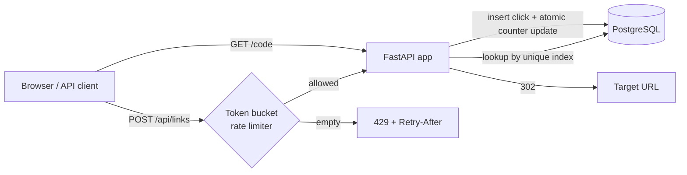

# Snip — URL shortener with click analytics


A URL shortener built with **FastAPI**, **SQLAlchemy** and **PostgreSQL**. It creates short links (random or custom aliases, with optional expiry), redirects them, records every click, and shows per-link analytics on a small dashboard.

**Live demo:** _add your Render URL here_ · **API docs:** `/docs` (auto-generated OpenAPI)

---

## Features

- **Short links**: 7-character random base62 codes, or a custom alias (`/my-link`)
- **Expiring links**: optional lifetime; expired links return `410 Gone`
- **Click analytics**: total clicks, clicks per day (last 30 days) and top referrers
- **Rate limiting**: token-bucket limiter per client IP on link creation, returning `429` with a `Retry-After` header
- **Dashboard**: dependency-free HTML/JS page to create links and view stats
- **Tested**: 27 tests covering the API, collision handling, expiry, rate limiting and base62 encoding
- **Ships with** a Dockerfile, a docker-compose setup with Postgres, GitHub Actions CI, and a one-click Render blueprint

## Quick start

**Local (SQLite, no setup):**
```bash
python -m venv .venv
.venv\Scripts\activate          # macOS/Linux: source .venv/bin/activate
pip install -r requirements-dev.txt
uvicorn app.main:app --reload
```
Open http://localhost:8000 for the dashboard and http://localhost:8000/docs for the API.

**With Postgres (Docker):**
```bash
docker compose up --build
```

**Tests:**
```bash
pytest -v
```

## API

| Method | Path | Description |
|---|---|---|
| `POST` | `/api/links` | Create a link. Body: `{"url": "...", "alias"?: "...", "expires_in_hours"?: 24}` |
| `GET` | `/api/links` | List recent links (newest first) |
| `GET` | `/api/links/{code}/stats` | Click totals, per-day series, top referrers |
| `DELETE` | `/api/links/{code}` | Delete a link and its click history |
| `GET` | `/{code}` | Redirect (`302`) and record the click |
| `GET` | `/health` | Health check used by the hosting platform |

```bash
curl -X POST http://localhost:8000/api/links \
  -H "Content-Type: application/json" \
  -d '{"url": "https://github.com/fastapi/fastapi", "alias": "fastapi"}'
```

## Architecture



```
app/
├── main.py        # app factory + routes
├── models.py      # Link and Click tables, indexes
├── schemas.py     # request/response models (validation)
├── shortcode.py   # base62 + random code generation + alias rules
├── ratelimit.py   # token bucket limiter
├── database.py    # engine/session setup
├── config.py      # env-driven settings
└── static/        # dashboard (HTML/CSS/JS)
tests/
├── test_api.py    # end-to-end through the HTTP layer
└── test_units.py  # base62 and rate limiter with a fake clock
```

**Data model**

- `links`: `code` (unique index), `target_url`, `created_at`, `expires_at`, `click_count`
- `clicks`: `link_id`, `clicked_at`, `referrer`, `user_agent`, with a composite index on `(link_id, clicked_at)` for the stats queries

## Design decisions

**Random codes instead of encoding the auto-increment ID.**
Encoding the row ID in base62 gives short, collision-free codes, but they're sequential, so anyone can enumerate every link in the system. Random 7-character base62 codes give 62⁷ ≈ 3.5 trillion possibilities and can't be guessed.

**Collisions are resolved by the database, not by check-then-insert.**
"Check whether the code exists, then insert" is a race: two requests can both see a code as free. Instead the app inserts directly and lets the `UNIQUE` constraint arbitrate. On an `IntegrityError` it retries with a new code (up to 5 times). A custom alias that's taken returns `409 Conflict`.

**Click counter updated with SQL `click_count = click_count + 1`.**
Reading the count in Python, adding one and writing it back would lose updates under concurrent clicks. The atomic SQL update avoids that. The counter is denormalized so listing links doesn't need a `COUNT(*)` over the clicks table, while the raw `clicks` rows remain the source of truth for time-series stats.

**`302` instead of `301` redirects.**
Browsers cache `301 Moved Permanently` and stop asking the server, so repeat visits would never be counted. `302` keeps analytics accurate at the cost of one extra request to the shortener.

**Token bucket for rate limiting.**
It allows a short burst (10 links by default) while capping the sustained rate (1 link per 5s). That's friendlier than a fixed window, which lets clients double their quota at window boundaries. The clock is injectable, so the tests check refill behaviour without sleeping.

**Security**

- Only `http`/`https` URLs are accepted, which blocks `javascript:` and similar schemes.
- Aliases can't shadow app routes (`api`, `docs`, `static`, …).
- The dashboard inserts user data with `textContent` only, so stored URLs can't cause XSS.
- The Docker image runs as a non-root user.

## Tradeoffs and what I'd do next

| Limitation today | At larger scale |
|---|---|
| Rate-limit state is in-process, so each instance limits on its own | Move the buckets to Redis (atomic Lua script) for one global limit |
| Each redirect hits the database | Put a Redis read-through cache in front of `code → url` lookups. Redirects are very read-heavy |
| Each click is written synchronously during the redirect | Push click events to a queue (Redis Streams / Kafka) and batch-insert them, so redirect latency doesn't depend on write load |
| Tables are created at startup | Use Alembic migrations |
| No user accounts | Add auth so users only see and delete their own links |
| Stats are computed per request | Pre-aggregate daily counts with a rollup job once click volume grows |

## Deploying (Render, free tier)

1. Push this repo to GitHub.
2. In Render: **New → Blueprint**, then select the repo. `render.yaml` creates the web service and a Postgres database and wires `DATABASE_URL` automatically.
3. Put the resulting URL in the "Live demo" line above.

## Configuration

| Variable | Default | Purpose |
|---|---|---|
| `DATABASE_URL` | `sqlite:///./shortener.db` | Any SQLAlchemy URL; `postgres://` URLs are normalized |
| `RATE_LIMIT_CAPACITY` | `10` | Burst size per client |
| `RATE_LIMIT_REFILL_PER_SEC` | `0.2` | Sustained rate (tokens per second) |
| `TRUST_PROXY` | `false` | Read the client IP from `X-Forwarded-For` (enable behind a load balancer) |
